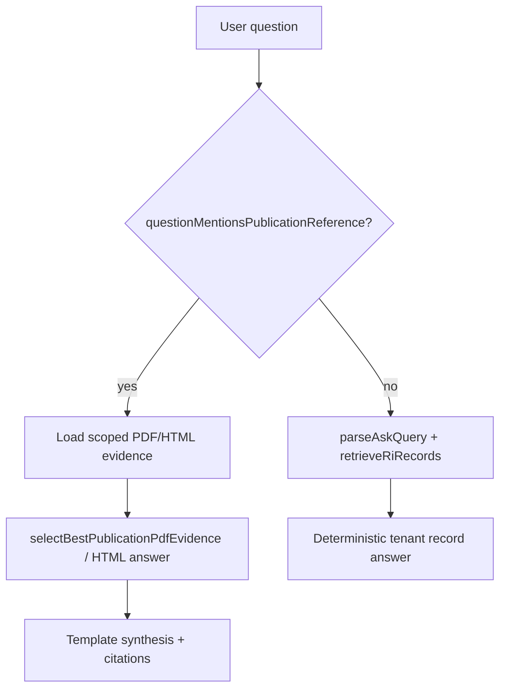
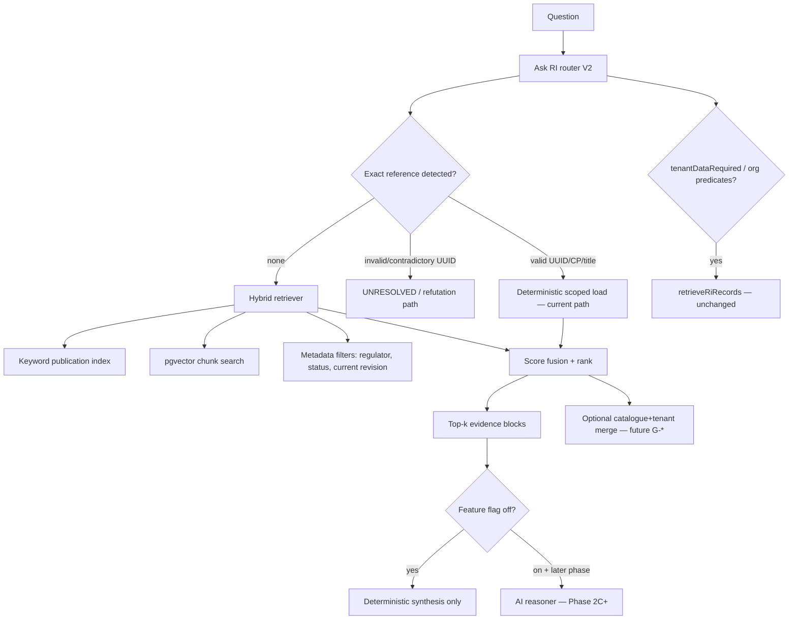
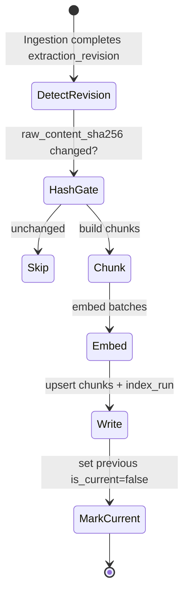

# FORGENIQ Ask RI V2 — Phase 2B.1 Semantic Regulatory Retrieval (Design Only)

**Checkpoint:** eval infrastructure `9e94e7c` · frozen suite `ask-ri-v2-eval-suite-v2.1.json` · baseline `deterministic-v2.1-r2-2026-11-10.json`

**Status:** Architecture and implementation plan — **no code, migrations, embeddings, or provider calls in this phase.**

---

## 1. Current retrieval architecture

### 1.1 Control flow (`runAskRiDeterministic`)



**Publication gate** (`publication-pdf-question-match.mjs`): catalogue path only when the question contains CP refs, publication UUIDs, or **quoted titles combined with** fair-value/consumer-duty phrases. Unquoted topical questions (Category **H**) fall through to **tenant graph retrieval** — the root cause of semantic discovery failures.

### 1.2 Reusable components (do not replace)

| Component | Role |
|-----------|------|
| `questionMentionsPublicationReference` | Exact-reference fast path (keep, extend with validation) |
| `resolveCataloguePublicationIdsForQuestion` | DB resolution for CP/UUID/title (expand as pre-filter) |
| `loadPublicationPdfEvidenceForAskRi` / HTML loaders | Revision-scoped evidence + integrity |
| `buildPdfEvidenceBlocks` / HTML block model | Chunk **sources** (paragraph/page/section) |
| `scorePublicationQuestionMatch`, `rankEvidenceBlocksForQuestion` | Keyword ranking within loaded publication |
| `answerAskRiFromBestPublicationPdfEvidence` / HTML | Deterministic answer + citation surface |
| `buildCatalogueEvidenceResult`, `mergeCatalogueCitations` | Execution metadata, mixed HTML/PDF |
| `parseAskQuery`, `retrieveRiRecords` | Tenant boundary (unchanged in 2B.1) |
| `regulatory_source_extraction_revisions` | Revision identity, SHA, storage paths |
| Frozen eval packs + offline harness | Regression without live DB |

### 1.3 Evidence block shape (today)

PDF blocks (`pdf-evidence-blocks.mjs`): `documentEvidenceId`, `publicationId`, `extractionRevisionId`, `pageNumber`, `sectionReference`, `extractedText`, integrity flags, `provenance`.

HTML: section/article blocks in `html_article_v2` profile (eval packs: `verifiedTextSamples`, `blockCount`).

Citations expose `publicationId`, `physicalPageNumber`, `evidenceId`, `type` (`html_article_v2` / `pdf_primary_v1`).

### 1.4 Tenant boundary

When the gate is false, **only** `tenant_ri_records` runs — no catalogue index scan. Category **G-04** fusion fails because catalogue and tenant branches are **mutually exclusive** today (eval R2: catalogue only, no tenant obligations in answer).

---

## 2. Root cause of failed semantic discovery

| Failure | Mechanism |
|---------|-----------|
| **H-01…H-05** | No publication phrase → tenant path → `UNRESOLVED` / `INSUFFICIENT` (R2: D01 0–1) |
| **A-04** | Supervisory webpage title without quoted-title pattern → tenant path |
| **False PASS (pre-R2)** | Retrieval-only scoring; fixed in 2A.6 |
| **Exact UUID adversarial (J-03)** | Wrong UUID still routes via keyword match to FG22 — needs **reference validation**, not semantic search |

Semantic retrieval addresses **topic → publication/chunk** when the gate is false. It does **not** replace false-premise handling or fusion.

---

## 3. Proposed V2 retrieval architecture



**Feature flag (default off):** `ASK_RI_SEMANTIC_CATALOGUE_V2=false` — production remains `runAskRiDeterministic` until offline eval gates pass.

---

## 4. Evidence chunking design

### 4.1 Source units

1. **Primary:** existing `evidenceBlocks` / `verifiedTextSamples` per `extraction_revision_id`.
2. **Do not re-parse PDFs** for chunking if structured paragraphs exist and `pageBoundaryConfirmed`.

### 4.2 Chunking profile `regulatory_semantic_v1`

| Parameter | Proposal |
|-----------|-----------|
| Target size | 400–800 tokens (~1.5–3k chars) |
| Overlap | 80–120 tokens between adjacent chunks in same section |
| Boundaries | Prefer paragraph breaks; never split numbered clauses (`kind: numbered_clause`) mid-text |
| HTML | One chunk per logical section/heading block where possible |
| Min chunk | 120 chars (skip boilerplate via existing `isFrontMatterOrNavigationalBlock` heuristics) |

### 4.3 Mandatory chunk metadata

Publication ID, regulator, title, **publication_status** (from `publication_metadata` / ingestion), extraction revision ID, original text, canonical URL, physical page or HTML section, `chunk_text_sha256`, `content_hash` (= revision `raw_content_sha256` or block fingerprint), `document_evidence_id`, `integrity_verified`, `chunking_profile`, `is_current_for_publication`.

### 4.4 Traceability

Every search hit returns chunk row → `extraction_revision_id` + `document_evidence_id` → same citation contract as today. Answer synthesis still forbidden from inventing pages not in chunk metadata.

---

## 5. Supabase pgvector schema (unexecuted)

See: `docs/eval/design/ask-ri-semantic-chunks-pgvector-migration.sql`

### 5.1 Tables

- **`regulatory_evidence_chunks`** — chunk text + metadata + `embedding vector(N)`.
- **`regulatory_evidence_chunk_index_runs`** — indexing audit, failures, rollback pointer.

### 5.2 Indexes and query

- B-tree: `publication_id`, `extraction_revision_id`, `(publication_id, is_current_for_publication)`.
- pgvector: HNSW preferred for <500k chunks; IVFFlat if cost-constrained (rebuild on major revision waves).
- RPC `search_regulatory_evidence_chunks(query_embedding, filters…)` with **mandatory** `current_only` default true.

### 5.3 RLS

- **SELECT:** authenticated catalogue readers (align with `regulatory_publications` policies).
- **INSERT/UPDATE:** service role / ingestion worker only.
- **No tenant org_id** on chunk table — prevents accidental commingling.

### 5.4 Scale (order-of-magnitude)

| Corpus | Chunks (est.) | Storage (768-dim) | Notes |
|--------|----------------|-------------------|-------|
| 50 pubs × 80 pages | ~8k–15k | <200 MB vectors + text | Staging pilot |
| 500 pubs | ~150k | ~1–2 GB | HNSW maintenance periodic |

Latency target: **p95 < 150 ms** vector search + **< 50 ms** metadata filter at staging scale (connection pooler, limit `match_count` ≤ 24).

---

## 6. Embedding model comparison (no selection call in 2B.1)

### Option A — Hosted API (e.g. OpenAI `text-embedding-3-small/large`, Voyage, Cohere)

| Criterion | Assessment |
|-----------|------------|
| Quality | Strong on general + legal-ish English; good FCA acronyms with fine-tuning N/A |
| Dimensions | 512–3072 (configurable on some providers) |
| Cost | Low per million tokens for **indexing**; **per-query** cost if questions embedded server-side |
| Latency | 50–200 ms round-trip EU/US |
| UK/EU | Review DPA, SCCs, subprocessors; **user questions may contain confidential text** |
| Ops | Simplest CI/index jobs |

### Option B — Self-hosted (e.g. `bge-m3`, `e5-large-v2`, `gte-Qwen2` via ONNX/TEI)

| Criterion | Assessment |
|-----------|------------|
| Quality | Competitive on domain text; may need eval on CP26/FG22 phraseology |
| Infra | 2–4 vCPU + 8–16 GB RAM small model; GPU optional |
| Cost | Fixed compute; no per-token API; **engineering + patching** |
| Governance | Query embeddings never leave estate — **best for confidential questions** |
| Ops | Model versioning, cold start, autoscaling |

### Query embedding governance (required either way)

| Strategy | Description |
|----------|-------------|
| **Q1 — Sanitise before embed** | Strip org names, account IDs, internal refs; embed sanitised string only |
| **Q2 — Local query encoder** | Self-host **query** model; send only public corpus to hosted index build |
| **Q3 — Dual path** | Semantic retrieval uses **topic extraction** (rules + small local model) → embed topic string, not raw question |

**Recommendation (pending approval):** **Index:** hosted or batch self-hosted (public FCA text only). **Query:** **self-hosted query embedding** (Option B lite, e.g. TEI sidecar) in production OR Q3 topic strings to avoid shipping full user questions to third parties. Re-evaluate cost after staging corpus size known.

---

## 7. Hybrid retrieval and ranking

### Stage 1 — Reference layer (unchanged behaviour)

- CP / UUID / quoted title → `resolveCataloguePublicationIdsForQuestion` → scoped evidence load.
- **UUID validation:** if question UUID ≠ resolved publication UUID for cited evidence → **do not PASS retrieval** (fixes J-03 class).

### Stage 2 — Candidate generation

| Channel | Weight role |
|---------|-------------|
| Exact publication match | Hard filter / +100 score |
| Keyword publication index (title, ref, url tokens) | +0–40 |
| Semantic k-NN (k=24) | Cosine similarity 0–1 |
| Metadata boost | `finalised_guidance` vs `consultation` match intent |
| Freshness | `is_current_for_publication` only unless `historical=true` query flag |

### Stage 3 — Fusion (RRF or weighted)

Proposed **weighted RRF** with `k=60`:

```
score = w_exact * exact_hit
      + w_kw * norm(keyword_pub_score)
      + w_sem * sem_similarity
      + w_block * norm(block_keyword_score)
```

Default weights (tune on eval): `w_exact=3.0`, `w_kw=1.0`, `w_sem=1.2`, `w_block=0.8`.

**Regulatory status:** from `publication_status` column / metadata — **never** inferred from embedding alone. Consultation language mandatory in synthesis templates when status=`consultation`.

### Stage 4 — Block selection

Reuse `rankEvidenceBlocksForQuestion` on semantic shortlist; cap citations at 12 (existing).

---

## 8. Incremental indexing lifecycle



- **Append-only revisions** — historical chunks kept; `is_current_for_publication=false` + `superseded_at`.
- **Dedup:** `unique (extraction_revision_id, chunk_index, chunking_profile)`.
- **Failure:** `chunk_index_runs.status=failed`; prior current chunks remain.
- **Rollback:** revert `is_current` flags to last successful run id (no delete of history).

Trigger: post-commit hook from ingestion pipeline (Phase 8C extractor), not Ask RI request path.

---

## 9. Ask RI integration (design)

| Concern | Approach |
|---------|----------|
| Router | New `resolveAskRiEvidencePlan(question, flags)` before branch |
| Discovery | If `!mentionsPublicationReference` and flag on → hybrid search → attach top publications’ evidence lists to state |
| Multi-publication | Allow multiple `publicationId` in state (max 3–4) |
| Citations | Same `buildCatalogueEvidenceResult` |
| Insufficient | No chunks above threshold → `INSUFFICIENT_EVIDENCE` (not tenant fallback) |
| Tenant | Unchanged; explicit `tenantDataRequired` still uses graph |
| Fallback | Flag off → identical to today |
| Fusion (G-04) | **Out of 2B.1 scope** — design hook: second phase merges tenant + catalogue in composer |

**Files (future implementation):** `run-ask-ri.mjs`, new `semantic-catalogue-retrieval.mjs`, `load-publication-*` (multi-pub), `server-actions-ask-ri.ts` (flag), env vars.

---

## 10. Evaluation impact (framework frozen)

### 10.1 Cases likely to improve from **retrieval alone** (D01/D02/D03)

| IDs | Expected retrieval delta |
|-----|-------------------------|
| **H-01, H-02, H-05** | Fair value / consumer duty discovery |
| **H-03, H-04** | Financial crime / fraud → CP26 |
| **A-04** | Supervisory webpage by topic |
| **(partial) C-04** | If gate misses CP variant phrasing |

### 10.2 Still need reasoning / fusion (not 2B.1)

| IDs | Gap |
|-----|-----|
| **C-01** | Control-impact themes (R2: missing narrative) |
| **G-04** | Catalogue + tenant fusion |
| **E-*, F-*** | Tenant narrative quality |
| **J-03** | Reference integrity (rules, not vectors) |

### 10.3 Acceptance targets (vs R2 baseline, same engine synthesis)

| Metric | Current (H) | Target (semantic only) |
|--------|-------------|-------------------------|
| D01 ≥ 2 on H-* | 0/5 | ≥ 4/5 |
| D02 = 3 on H-* | 0/5 | ≥ 4/5 |
| Wrong publication (CF-04) | 0 | 0 regression |
| J-03 outcome | FAIL | FAIL (must stay) |
| Exact CP/UUID cases (A-02, C-01, D-*) | Mostly retrieval OK | No regression |
| p95 retrieval latency (staging) | N/A | ≤ 250 ms added |

Run: `ask-ri-v2-eval-suite-v2.1.json` → new baseline **only after** implementation; compare to `deterministic-v2.1-r2-2026-11-10.json`.

---

## 11. Implementation sequence (approval gates)

| Stage | Deliverable | DB | Approval |
|-------|-------------|-----|----------|
| **A** Chunk builder from revisions | CLI `index-chunks-dry-run` | None | Operator |
| **B** Embedding provider PoC | Offline quality on 100 chunks | None | Operator + legal |
| **C** Apply pgvector migration | SQL | **Yes** | Operator |
| **D** Indexing worker | Service role job | Writes chunks | Operator |
| **E** Hybrid retriever lib | Unit tests | Read | Eng |
| **F** Ask RI integration + flag | Staging only | None | Operator |
| **G** Offline eval rerun | New baseline file | None | Operator |
| **H** Staging UAT | Dashboard checklist | None | Operator |

**Rollback:** flag off; mark index run failed; chunks `is_current=false`.

---

## 12. Security and data governance

- **Index content:** public FCA catalogue only.
- **Queries:** treat as confidential; prefer local query embedding or sanitised topic strings.
- **RLS:** no cross-tenant reads on chunk table; no org_id column.
- **Audit:** log `match_publication_ids`, scores — not full user question in third-party logs.

---

## 13. Outstanding decisions (operator)

1. Hosted vs self-hosted **query** embeddings (legal review).
2. Vector dimensions + model lock (affects migration `vector(N)`).
3. Approval to apply `ask-ri-semantic-chunks-pgvector-migration.sql`.
4. Corpus scope for pilot (CP26 + FG22 + Fair Value HTML vs full catalogue).
5. Fusion (G-04) scheduling — separate workstream from 2B.1.
6. AI reasoner phase (2C) after retrieval eval passes.

---

## 14. Infrastructure estimate (staging pilot)

- Supabase: enable `vector`; +~500 MB storage for pilot chunks.
- Optional: Fly.io/Vercel sandbox or small VM for query encoder (if self-hosted).
- No production deployment in 2B.1.

---

*End of Phase 2B.1 design. Await architectural approval before implementation.*
